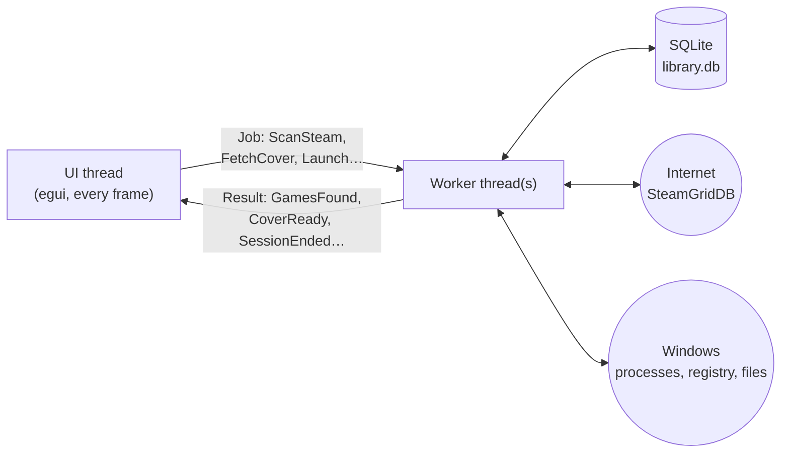

# 02 Architecture (Section 1)

Back to [[00 Home]] · Next: [[03 Data Model]]

## Shape
One Rust program (a single Cargo crate) built with **eframe**, the app framework egui runs in. The **game logic doesn't know the UI exists**. It lives in its own modules, so it's easy to test, and the UI code stays thin.

```
gamelib/
├─ Cargo.toml
├─ src/
│  ├─ main.rs          starts the app
│  ├─ app.rs           AppState: everything the UI is showing right now
│  ├─ model.rs         Game, Source, LaunchTarget… core types
│  ├─ db.rs            saving/loading (SQLite)
│  ├─ sources/
│  │   ├─ mod.rs       the GameSource trait
│  │   ├─ steam.rs  epic.rs  gog.rs  folder.rs
│  ├─ launcher.rs      starts games
│  ├─ playtime.rs      tracks running games → play sessions
│  ├─ metadata.rs      downloads cover art & info
│  ├─ worker.rs        background thread + job/result messages
│  └─ ui/
│      ├─ library.rs  details.rs  stats.rs  settings.rs  import.rs
└─ tests/fixtures/     sample manifest files for tests
```

## The key idea: never block the UI
egui redraws the window about **60 times a second**. If the UI waits on something slow (scanning a drive, downloading a cover, waiting for a game to close), the app freezes.

So **slow work runs on background threads**:



- The UI **sends a job** down a channel (`std::sync::mpsc::Sender<Job>`).
- A worker does the job and **sends a result back** (`Sender<WorkerResult>`).
- Each frame, the UI **checks for results** with `try_recv()`, which never blocks, updates its state, and calls `ctx.request_repaint()`.

This one pattern (threads plus channels) is most of the "hard Rust" in the project. See [[11 Rust Learning Path]].

## Crates (libraries)
| Crate | Used for |
|---|---|
| `eframe`, `egui` | the window and widgets |
| `egui_extras` (with image features), `image` | showing cover images |
| `egui_plot` | charts on the stats page |
| `rusqlite` (feature `bundled`) | SQLite database, nothing extra to install |
| `steamlocate` | finding Steam libraries and installed games |
| `serde`, `serde_json` | reading Epic's manifest files |
| `winreg` | reading GOG entries from the Windows registry |
| `walkdir` | folder scan |
| `sysinfo` | seeing which processes are running, for playtime |
| `reqwest` (feature `blocking`, `json`) | calling the cover-art API |
| `rfd` | native "choose a file / folder" dialogs |
| `directories` | finding `%APPDATA%` properly |
| `anyhow` | simple error handling |

> [!tip] Version numbers
> Add crates with `cargo add <name>` so you get the current version. Don't copy version numbers from old tutorials.
