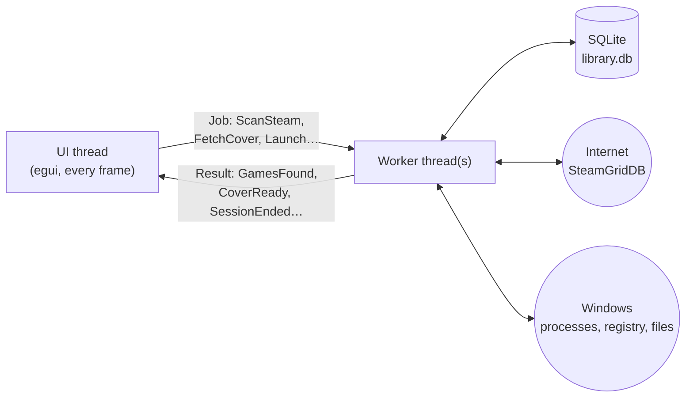
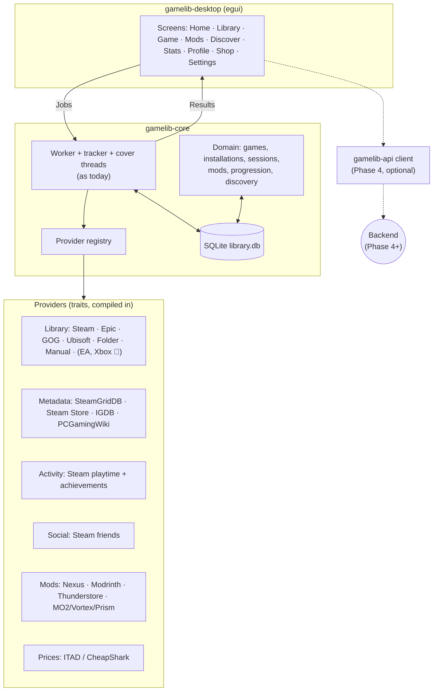

# 02 Architecture (Section 1)

Back to [[00 Home]] · Next: [[03 Data Model]]

> [!note] As built (13 Nov 2026)
> The idea on this page is what was built: logic separate from the UI, and slow work on background threads talking to the UI through channels. Some details changed along the way:
> - There is no `app.rs`; the app's state is in `ui/mod.rs`. `db.rs` grew into a `db/` folder, and `stats.rs`, `profile.rs`, `friends.rs`, `shop.rs`, `paths.rs` and `cli.rs` were added.
> - Besides the one worker thread there is a tracker thread per running game and a separate thread for cover downloads, each with its own database connection.
> - Charts are drawn by hand with egui's painter, so `egui_plot` isn't used.
>
> The up-to-date file list and diagram are in the code's `README.md`.

> [!info] Plan review, 13 Nov 2026
> Added at the bottom: [[#Limitations found in the review]] and [[#Where the architecture is heading]]. The core idea on this page (logic separate from UI, worker threads + channels) **stays**. Details: [[21 Provider Architecture]] · Change notes: [[18 Plan Review 2026-11-13]].

## Shape
One Rust program (a single Cargo crate) built with **eframe**, the app framework egui runs in. The **game logic doesn't know the UI exists**. It lives in its own modules, so it's easy to test, and the UI code stays thin.

```
gamelib/
├─ Cargo.toml
├─ src/
│  ├─ main.rs          starts the app
│  ├─ app.rs           AppState: everything the UI is showing right now
│  ├─ model.rs         Game, Source, LaunchTarget… core types
│  ├─ db.rs            saving/loading (SQLite)
│  ├─ sources/
│  │   ├─ mod.rs       the GameSource trait
│  │   ├─ steam.rs  epic.rs  gog.rs  folder.rs
│  ├─ launcher.rs      starts games
│  ├─ playtime.rs      tracks running games → play sessions
│  ├─ metadata.rs      downloads cover art & info
│  ├─ worker.rs        background thread + job/result messages
│  └─ ui/
│      ├─ library.rs  details.rs  stats.rs  settings.rs  import.rs
└─ tests/fixtures/     sample manifest files for tests
```

## The key idea: never block the UI
egui redraws the window about **60 times a second**. If the UI waits on something slow (scanning a drive, downloading a cover, waiting for a game to close), the app freezes.

So **slow work runs on background threads**:



- The UI **sends a job** down a channel (`std::sync::mpsc::Sender<Job>`).
- A worker does the job and **sends a result back** (`Sender<WorkerResult>`).
- Each frame, the UI **checks for results** with `try_recv()`, which never blocks, updates its state, and calls `ctx.request_repaint()`.

This one pattern (threads plus channels) is most of the "hard Rust" in the project. See [[11 Rust Learning Path]].

## Crates (libraries)
| Crate | Used for |
|---|---|
| `eframe`, `egui` | the window and widgets |
| `egui_extras` (with image features), `image` | showing cover images |
| `egui_plot` | charts on the stats page |
| `rusqlite` (feature `bundled`) | SQLite database, nothing extra to install |
| `steamlocate` | finding Steam libraries and installed games |
| `serde`, `serde_json` | reading Epic's manifest files |
| `winreg` | reading GOG entries from the Windows registry |
| `walkdir` | folder scan |
| `sysinfo` | seeing which processes are running, for playtime |
| `reqwest` (feature `blocking`, `json`) | calling the cover-art API |
| `rfd` | native "choose a file / folder" dialogs |
| `directories` | finding `%APPDATA%` properly |
| `anyhow` | simple error handling |

> [!tip] Version numbers
> Add crates with `cargo add <name>` so you get the current version. Don't copy version numbers from old tutorials.

---

## Limitations found in the review
*(13 Nov 2026, from reading the code, not the docs.)* None of these are bugs; they're the places that would make the long-term vision ([[19 Product Vision]]) expensive if left alone.

| # | Limitation | Where | Why it matters later | Fix (phase) |
|---|---|---|---|---|
| 1 | A `games` row is one installation from one store (`UNIQUE(source, source_id)`) | `db/mod.rs`, `db/games.rs` | Same game on two stores = two entries, split playtime; can't store owned-not-installed or wishlisted games; mods have nothing stable to attach to | Games/installations/ownerships split, [[20 Game Identity and Installation Model]] (Phase 1, M11) |
| 2 | `Source` is a closed enum, matched in **13 files** incl. `ui/theme.rs` colours and labels | `model.rs` + many | Each new store touches the whole app | `ProviderId` + `ProviderInfo`, [[21 Provider Architecture]] (M10) |
| 3 | Sources are listed by hand in `enabled_sources()`; metadata (SteamGridDB, Steam Store) and friends (Steam) are called directly | `sources/mod.rs`, `worker.rs`, `metadata.rs`, `friends.rs` | No common place for API keys, rate limits, caching, enable/disable | Provider registry + `ProviderCtx` (M10) |
| 4 | Playtime only works when a game's exe runs **inside its install folder**, and only for games started from GameLib | `playtime.rs` | Fails for games behind wrapper launchers, possibly for Xbox/`WindowsApps` titles, and misses play started from Steam | Optional extra watch paths per installation (M13); optional "track games started elsewhere" (M15) |
| 5 | API keys in plain text in `settings` | `db/settings.rs` | Becomes unacceptable once account tokens exist | Windows Credential Manager (M10) |
| 6 | Single crate | `Cargo.toml` | Slower rebuilds (egui), "core never imports UI" is only a convention, a future server can't reuse types cleanly | Workspace `gamelib-core` + `gamelib-desktop` (M10) |
| 7 | `ui/mod.rs` holds all app state (1,092 lines) | `ui/mod.rs` | Each new screen (Discover, Mods, Community) grows it further | Split state per screen as screens are added (ongoing) |
| 8 | One `Job` enum for everything | `worker.rs` | Fine now; grows with every feature | Group jobs by domain (`Job::Library(..)`, `Job::Mods(..)`) when Phase 2 starts |
| 9 | No CI | repo | Windows-only failures were found by hand ([[09 Milestones#Found and fixed while polishing (13 Nov 2026)]]) | GitHub Actions on `windows-latest` (M9) |

What is **good and should be kept**: the UI/logic separation; pure, tested decision functions (`playtime::step`, reward rules, parsers against fixtures); per-thread DB connections with WAL; one-transaction scans and purchases; migrations that refuse newer databases; failures in one source never stopping the others.

## Where the architecture is heading
> [!todo] 🔜 Phase 1 (M10) onwards. Proposed, not built.


- **Same threading model.** Providers run inside today's worker/cover threads; no async runtime in the desktop app.
- **Providers return plain data, the core saves it.** Providers never get the DB connection, which keeps them fixture-testable and could later allow out-of-process plugins.
- **Online is a separate, optional module.** The desktop works the same with it switched off.
- Full detail: [[21 Provider Architecture]], [[22 Modding Architecture]], [[24 Backend and Cloud Infrastructure]].
