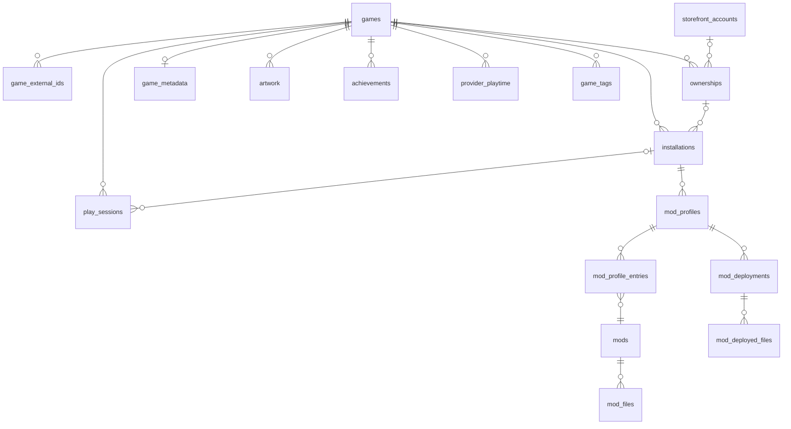

# 03 Data Model (Section 2)

Back to [[00 Home]] · Prev: [[02 Architecture]] · Next: [[04 Game Sources]]

> [!info] Plan review, 13 Nov 2026: what changed on this page
> - The first half now describes the schema **as built** (v2), checked against `gamelib/src/db/mod.rs`. Before, it was the 12 Nov draft; the built version adds a few columns (listed below).
> - New: [[#Proposed schema v3+ (not built)]] for the long-term vision, and [[#Local vs online data]].
> - The concept behind v3 (one game, many installations and ownerships) is explained in [[20 Game Identity and Installation Model]].
> - The original draft is kept in Git history (commit `733e6e3`). Full list of plan changes: [[18 Plan Review 2026-11-13]].

## ✅ As built: schema v2

### In Rust (`model.rs`)
```rust
pub enum Source { Steam, Epic, Gog, Folder, Manual }

/// How to start the game.
pub enum LaunchTarget {
    /// Run an .exe directly (GOG, folder scan, manual)
    Exe { path: PathBuf, args: Vec<String>, working_dir: Option<PathBuf> },
    /// Ask a launcher to start it (Steam, Epic), e.g. "steam://rungameid/570"
    Uri(String),
}

pub struct Game {
    pub id: i64,                    // database id
    pub title: String,
    pub source: Source,
    pub source_id: String,          // Steam app id, Epic AppName, GOG id, or exe path
    pub install_dir: Option<PathBuf>,
    pub launch: LaunchTarget,
    pub favourite: bool,
    pub hidden: bool,
    pub installed: bool,            // false when a rescan no longer finds it (added while building)
    pub playtime_secs: u64,
    pub last_played: Option<i64>,   // unix timestamp
    pub added_at: i64,
    pub cover_path: Option<PathBuf>,
    pub description: Option<String>,
    pub genres: Vec<String>,
    pub release_year: Option<u16>,
}
```
`enum` plus `match` is the Rust feature that makes this tidy: the compiler forces you to handle every source and launch type. (That same closed enum is what Phase 1 replaces with a provider id, so new stores don't need edits in 13 files: see [[21 Provider Architecture]].)

### In SQLite (`db/mod.rs`, migration v1)
```sql
games(
  id INTEGER PRIMARY KEY,
  title TEXT NOT NULL,
  source TEXT NOT NULL,            -- 'steam' | 'epic' | 'gog' | 'folder' | 'manual'
  source_id TEXT NOT NULL,
  install_dir TEXT,
  launch_kind TEXT NOT NULL,       -- 'exe' | 'uri'
  launch_value TEXT NOT NULL,      -- exe path or URI
  launch_args TEXT,                -- JSON array
  launch_working_dir TEXT,         -- (added while building)
  favourite INTEGER NOT NULL DEFAULT 0,
  hidden INTEGER NOT NULL DEFAULT 0,
  installed INTEGER NOT NULL DEFAULT 1,      -- (added while building)
  playtime_secs INTEGER NOT NULL DEFAULT 0,
  last_played INTEGER,
  added_at INTEGER NOT NULL,
  cover_path TEXT,
  cover_manual INTEGER NOT NULL DEFAULT 0,   -- (added) hand-picked covers are never overwritten
  description TEXT,
  genres TEXT,                     -- JSON array
  release_year INTEGER,
  UNIQUE(source, source_id)        -- stops duplicates on rescan
)

tags(id INTEGER PRIMARY KEY, name TEXT UNIQUE NOT NULL COLLATE NOCASE, is_collection INTEGER NOT NULL DEFAULT 0)
game_tags(game_id → games ON DELETE CASCADE, tag_id → tags ON DELETE CASCADE, PRIMARY KEY(game_id, tag_id))

play_sessions(id INTEGER PRIMARY KEY, game_id → games ON DELETE CASCADE,
              started_at INTEGER NOT NULL, ended_at INTEGER, duration_secs INTEGER NOT NULL DEFAULT 0,
              closed INTEGER NOT NULL DEFAULT 0)   -- (added) 1 once added to games.playtime_secs

settings(key TEXT PRIMARY KEY, value TEXT NOT NULL)   -- API keys, scan folders, enabled sources, equipped items
```

**Migration v2** (Profile and Shop; details in [[16 Profile and Friends#Data (adds to 03 Data Model)]] and [[17 Shop#Data (adds to 03 Data Model)]]):
`profile` (one row; also `name_chosen`), `profile_showcase`, `profile_badges`, `friends_cache`, `stardust_ledger`, `owned_items`.

### Design choices (as built)
- **Collections are tags with `is_collection = 1`.** "Backlog" is a tag that also appears in the sidebar. One system instead of two. *(Still to confirm in [[12 Decisions Log]].)*
- **Rescans never delete your data.** `UNIQUE(source, source_id)` means a rescan updates title, path and launch info, but keeps favourites, tags, playtime and covers.
- **Uninstalled games** aren't deleted. They're shown greyed out ("not installed"), keeping their playtime history.
- **Playtime is stored twice on purpose**: per session in `play_sessions` (stats) and as a total in `games.playtime_secs` (fast grid). `closed` stops a crash counting a session twice.
- **Schema versioning**: `PRAGMA user_version`; each migration runs once, in a transaction; a database from a *newer* GameLib is refused ✅ (tested).

### Known limits of v2 (found in the plan review)
- One row = **one installation from one store**. The same game on Steam and GOG is two unrelated entries with split playtime. → [[20 Game Identity and Installation Model]]
- No way to store a game you **own but haven't installed**, or a **wishlisted** game.
- Metadata is three columns on `games`, filled only for Steam games.
- `stardust_ledger.game_id` has no foreign key, so deleting and re-adding a game gives it a new id and the "finished once per game" reward can be earned again ([[26 Progression and Stardust Economy#Weak spots in today's rewards (found in the code review)]]).
- API keys are plain text in `settings` ([[12 Decisions Log#Still open]]).

### Where files live
```
%APPDATA%\gamelib\
├─ library.db
├─ covers\<game id>.<ext>
├─ profile\          avatar and uploaded banner
└─ gamelib.log       (+ gamelib.log.old)
```

---

## Proposed schema v3+ (not built)
> [!todo] 🔜 Phase 1 (library tables) · 🔭 Phase 2 (mods) · 🔭 Phase 3 (wishlist, progression) · 🔭 Phase 4 (links to a GameLib account)
> A proposal to review, not a final design. Migrations will be split into small steps (v3, v4…), each tested on a copy of a real v2 database. **Existing game ids are kept** so sessions, tags, showcase and ledger rows stay valid.



### Library core (Phase 1)
```sql
-- The canonical game: everything the USER decides lives here.
games(
  id INTEGER PRIMARY KEY,                 -- same ids as v2
  uuid TEXT UNIQUE NOT NULL,              -- stable id for cloud sync later (cheap to add now)
  title TEXT NOT NULL,
  sort_title TEXT,                        -- "Witcher 3" sorts under W
  favourite INTEGER NOT NULL DEFAULT 0,
  hidden INTEGER NOT NULL DEFAULT 0,
  status TEXT NOT NULL DEFAULT 'none',    -- none|wishlist|backlog|playing|finished|abandoned
  notes TEXT,
  preferred_installation_id INTEGER REFERENCES installations(id) ON DELETE SET NULL,
  playtime_secs INTEGER NOT NULL DEFAULT 0, -- GameLib-tracked total (cache of play_sessions)
  last_played INTEGER,
  added_at INTEGER NOT NULL,
  updated_at INTEGER NOT NULL
)

-- What each provider calls this game. The UNIQUE key is what makes matching safe.
game_external_ids(
  game_id INTEGER NOT NULL REFERENCES games(id) ON DELETE CASCADE,
  provider TEXT NOT NULL,                 -- steam|gog|epic|ubisoft|xbox|igdb|sgdb|nexus|thunderstore…
  external_id TEXT NOT NULL,              -- e.g. '1091500'; Nexus: game domain 'cyberpunk2077'
  PRIMARY KEY(provider, external_id)
)

-- A store account linked on this PC (Steam today via SteamID in profile). Secrets live in
-- Windows Credential Manager, never here.
storefront_accounts(
  id INTEGER PRIMARY KEY,
  provider TEXT NOT NULL,
  external_user_id TEXT NOT NULL,         -- e.g. SteamID64
  display_name TEXT,
  verified INTEGER NOT NULL DEFAULT 0,    -- 1 if proven (e.g. Sign in through Steam, Phase 4)
  linked_at INTEGER NOT NULL,
  UNIQUE(provider, external_user_id)
)

-- "I own it on X". Can exist without an installation.
ownerships(
  id INTEGER PRIMARY KEY,
  game_id INTEGER NOT NULL REFERENCES games(id) ON DELETE CASCADE,
  provider TEXT NOT NULL,
  external_id TEXT NOT NULL,
  account_id INTEGER REFERENCES storefront_accounts(id) ON DELETE SET NULL,
  how TEXT NOT NULL,                      -- detected (inferred from an install) | account (API) | manual
  first_seen_at INTEGER NOT NULL,
  last_seen_at INTEGER NOT NULL,
  UNIQUE(provider, external_id)           -- one licence per store per PC is enough for us
)

-- Files on this PC + how to start them. Takes over v2's installation columns.
installations(
  id INTEGER PRIMARY KEY,
  game_id INTEGER NOT NULL REFERENCES games(id) ON DELETE CASCADE,
  ownership_id INTEGER REFERENCES ownerships(id) ON DELETE SET NULL,
  provider TEXT NOT NULL,                 -- who found it: steam|epic|gog|ubisoft|folder|manual…
  provider_key TEXT NOT NULL,             -- v2's source_id (app id, AppName, GOG id, exe path)
  install_dir TEXT,
  launch_kind TEXT NOT NULL,              -- exe|uri
  launch_value TEXT NOT NULL,
  launch_args TEXT,                       -- JSON array
  launch_working_dir TEXT,
  extra_watch TEXT,                       -- JSON: extra paths / process names for the playtime tracker
  installed INTEGER NOT NULL DEFAULT 1,
  version TEXT,
  first_seen_at INTEGER NOT NULL,
  last_seen_at INTEGER NOT NULL,
  UNIQUE(provider, provider_key)          -- keeps rescans idempotent, exactly like v2
)

-- So merges can be explained and undone.
game_merges(id INTEGER PRIMARY KEY, target_game_id INTEGER NOT NULL, merged_title TEXT NOT NULL,
            moved TEXT NOT NULL,          -- JSON: installation/ownership/external-id/session ids moved
            merged_at INTEGER NOT NULL)

-- Metadata, separate from user choices. `manual` = typed in by the user: never overwritten.
game_metadata(game_id INTEGER PRIMARY KEY REFERENCES games(id) ON DELETE CASCADE,
              description TEXT, release_date TEXT, developer TEXT, publisher TEXT,
              provider TEXT, fetched_at INTEGER, manual INTEGER NOT NULL DEFAULT 0)
game_genres(game_id INTEGER REFERENCES games(id) ON DELETE CASCADE, kind TEXT NOT NULL, -- genre|theme|mode
            name TEXT NOT NULL, PRIMARY KEY(game_id, kind, name))
artwork(game_id INTEGER REFERENCES games(id) ON DELETE CASCADE,
        kind TEXT NOT NULL,               -- cover|hero|logo|icon
        path TEXT NOT NULL, provider TEXT, manual INTEGER NOT NULL DEFAULT 0,
        PRIMARY KEY(game_id, kind))      -- replaces games.cover_path / cover_manual

-- Sessions gain which installation (and later which mod profile) was used,
-- and how many seconds counted for rewards after the idle filter.
play_sessions(... v2 columns ...,
              installation_id INTEGER REFERENCES installations(id) ON DELETE SET NULL,
              mod_profile_id INTEGER REFERENCES mod_profiles(id) ON DELETE SET NULL,
              reward_secs INTEGER)

-- Playtime a store reports. Shown beside GameLib's own; never added to it.
provider_playtime(game_id INTEGER REFERENCES games(id) ON DELETE CASCADE, provider TEXT NOT NULL,
                  playtime_secs INTEGER NOT NULL, last_played INTEGER, fetched_at INTEGER NOT NULL,
                  PRIMARY KEY(game_id, provider))

achievements(id INTEGER PRIMARY KEY, game_id INTEGER REFERENCES games(id) ON DELETE CASCADE,
             provider TEXT NOT NULL, api_name TEXT NOT NULL, name TEXT, description TEXT,
             icon_url TEXT, hidden INTEGER NOT NULL DEFAULT 0, unlocked_at INTEGER, fetched_at INTEGER NOT NULL,
             UNIQUE(game_id, provider, api_name))

saved_filters(id INTEGER PRIMARY KEY, name TEXT UNIQUE NOT NULL, query TEXT NOT NULL, -- JSON GameQuery
              sidebar_order INTEGER)
-- tags, game_tags: unchanged
```

### Modding (Phase 2)
```sql
mod_managers(id INTEGER PRIMARY KEY, provider TEXT NOT NULL,   -- mo2|vortex|prism|r2modman
             path TEXT NOT NULL, detected_at INTEGER NOT NULL, UNIQUE(provider, path))
mods(id INTEGER PRIMARY KEY, provider TEXT NOT NULL, external_mod_id TEXT NOT NULL,
     game_id INTEGER REFERENCES games(id) ON DELETE CASCADE,
     name TEXT NOT NULL, author TEXT, summary TEXT, page_url TEXT, image_url TEXT, fetched_at INTEGER,
     UNIQUE(provider, external_mod_id))                        -- a cache of repository data
mod_files(id INTEGER PRIMARY KEY, mod_id INTEGER REFERENCES mods(id) ON DELETE CASCADE,
          external_file_id TEXT NOT NULL, version TEXT, file_name TEXT, size_bytes INTEGER,
          sha256 TEXT, uploaded_at INTEGER, UNIQUE(mod_id, external_file_id))
mod_dependencies(mod_file_id INTEGER REFERENCES mod_files(id) ON DELETE CASCADE,
                 depends_on TEXT NOT NULL,                     -- repository reference string
                 optional INTEGER NOT NULL DEFAULT 0, PRIMARY KEY(mod_file_id, depends_on))
mod_profiles(id INTEGER PRIMARY KEY, uuid TEXT UNIQUE NOT NULL,
             installation_id INTEGER NOT NULL REFERENCES installations(id) ON DELETE CASCADE,
             name TEXT NOT NULL, adapter TEXT NOT NULL,        -- bepinex|folder_dropin|external
             external_ref TEXT,                                -- for read-only mirrors of MO2/Vortex profiles
             active INTEGER NOT NULL DEFAULT 0, created_at INTEGER NOT NULL, updated_at INTEGER NOT NULL,
             UNIQUE(installation_id, name))
mod_profile_entries(profile_id INTEGER REFERENCES mod_profiles(id) ON DELETE CASCADE,
                    mod_id INTEGER REFERENCES mods(id), mod_file_id INTEGER REFERENCES mod_files(id), -- pinned
                    enabled INTEGER NOT NULL DEFAULT 1, load_order INTEGER,
                    PRIMARY KEY(profile_id, mod_id))
mod_deployments(id INTEGER PRIMARY KEY, profile_id INTEGER REFERENCES mod_profiles(id) ON DELETE CASCADE,
                mod_file_id INTEGER REFERENCES mod_files(id), deployed_at INTEGER NOT NULL)
mod_deployed_files(deployment_id INTEGER REFERENCES mod_deployments(id) ON DELETE CASCADE,
                   rel_path TEXT NOT NULL, sha256 TEXT NOT NULL,
                   PRIMARY KEY(deployment_id, rel_path))       -- exact uninstall + conflict detection
```

### Discovery and progression (Phase 3)
```sql
-- Wishlist = a games row with status 'wishlist' and no ownership/installation.
price_watch(game_id INTEGER PRIMARY KEY REFERENCES games(id) ON DELETE CASCADE,
            target_price_cents INTEGER, currency TEXT, best_price_cents INTEGER, best_store TEXT,
            historical_low_cents INTEGER, checked_at INTEGER)
xp_ledger(id INTEGER PRIMARY KEY, amount INTEGER NOT NULL, reason TEXT NOT NULL,
          game_id INTEGER, created_at INTEGER NOT NULL)      -- same shape as stardust_ledger
themes(id TEXT PRIMARY KEY, name TEXT NOT NULL, tokens TEXT NOT NULL, -- JSON colour tokens
       source TEXT NOT NULL, created_at INTEGER NOT NULL)   -- builtin|created|imported
-- stardust_ledger, owned_items, profile*, unchanged
```

### Local side of social features (Phase 4)
```sql
-- friends_cache generalised to any provider
external_friends(provider TEXT NOT NULL, external_id TEXT NOT NULL, name TEXT NOT NULL, avatar_url TEXT,
                 state TEXT NOT NULL, playing TEXT, updated_at INTEGER NOT NULL,
                 PRIMARY KEY(provider, external_id))
publish_settings(section TEXT PRIMARY KEY,           -- profile.bio|showcase|stats|activity.sessions…
                 visibility TEXT NOT NULL DEFAULT 'private')   -- private|friends|followers|public
activity_outbox(id INTEGER PRIMARY KEY, kind TEXT NOT NULL, payload TEXT NOT NULL,
                created_at INTEGER NOT NULL, published_at INTEGER)  -- queue; works offline
-- profile gains: remote_user_id TEXT, handle TEXT (set when a GameLib account is linked)
```

## Local vs online data
| Data | Lives on the PC | Lives on a server (Phase 4+) |
|---|---|---|
| Games, installations, ownerships, external IDs | ✅ always (source of truth) | Only a game *key* (e.g. `igdb:1877`) when referenced by public content |
| Play sessions, playtime | ✅ always | Summaries the user publishes; server-side ledger for public Stardust |
| Metadata, artwork caches | ✅ cache | Optional shared metadata proxy cache |
| Tags, collections, notes, status, saved filters | ✅ | Only with cloud sync (Phase 6), opt-in |
| Mod profiles, deploy manifests | ✅ | Shared collections (Phase 5) as published copies |
| API keys / tokens | ✅ Windows Credential Manager | Server keys stay on the server |
| Local profile, Stardust, owned items | ✅ | Published profile copy; server ledger |
| GameLib account, handle, follows, friends, blocks | — | ✅ server only |
| Activity feed | outbox queue | ✅ |
| Reviews, lists, guides, screenshots, comments, reports | drafts only | ✅ |

### Server schema outline (Phase 4–5, Postgres or PocketBase, not designed in detail yet)
`users`, `profiles` (+ per-section visibility), `linked_accounts` (UNIQUE provider + external user id, `verified_at`), `follows`, `friendships`, `blocks`, `activity` (with `expires_at`), `game_keys` (shared game identity across users, keyed by IGDB id), `reviews` (one per user per game), `lists` + `list_items`, `mod_collections` (manifest JSON), `screenshots`, `guides`, `comments`, `reports`, `moderation_actions`, `stardust_ledger` (server copy). See [[23 Social Platform Architecture]] and [[24 Backend and Cloud Infrastructure]].
