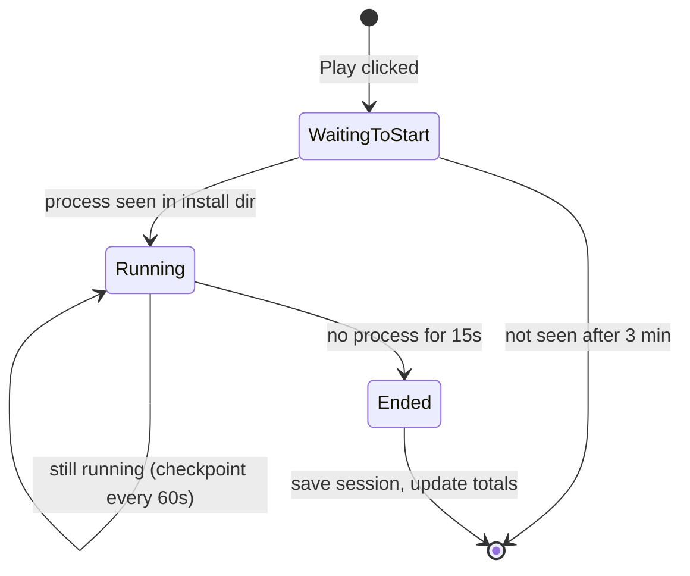

# 05 Launching and Playtime (Section 3, draft)

Back to [[00 Home]] · Prev: [[04 Game Sources]] · Next: [[06 Metadata and Cover Art]]

> [!warning] Draft
> Not agreed yet.

> [!info] Plan review, 13 Nov 2026
> Built ✅ as described, with the changes listed in the README (launcher links opened with `rundll32 url.dll,FileProtocolHandler`; a session ends when the game was last seen; crash recovery ignores sessions active in the last 3 minutes). Not yet checked by hand: a full Steam/Epic session ([[09 Milestones]]).
> **Known gaps for the long-term plan:** games whose exe runs *outside* the install folder (wrapper launchers, anti-cheat), possibly Xbox/`WindowsApps` titles, and play started outside GameLib. Planned: optional extra watch paths per installation (M13) and opt-in tracking of games started elsewhere (M15). With several installations per game, the Play button uses the **preferred installation** ([[20 Game Identity and Installation Model#Launching with several installations]]). Rewards will use idle-filtered time ([[26 Progression and Stardust Economy]]).

## Launching (`launcher.rs`)
```rust
match &game.launch {
    LaunchTarget::Exe { path, args, working_dir } => {
        // std::process::Command::new(path).args(args).current_dir(...).spawn()
    }
    LaunchTarget::Uri(uri) => {
        // Hand the URI to Windows: Command::new("cmd").args(["/C", "start", "", uri])
    }
}
```
After launching, tell the playtime tracker: "watch for game X".

## The playtime problem
The obvious approach is "start a timer when we launch, stop when the process exits". **That doesn't work for Steam and Epic**: we only launch a URI, the launcher starts the game itself, and the process we started exits straight away.

## The approach: watch the install folder
A game counts as **running when any process's `.exe` lives inside that game's install folder**. This works for every source. For manual games, use the exe's own folder.

`playtime.rs` runs on a background thread:
1. **Launch** → state becomes `WaitingToStart`. Every 2 seconds, use `sysinfo` to list processes and check for one inside the install folder.
2. Process found → `Running`. Create a `play_sessions` row with `started_at`.
3. While `Running`, check every 5 seconds. **Update the session row every minute**, so that if the PC crashes you lose at most a minute.
4. No matching process for 15 seconds in a row → `Ended`. Close the session, add the time to `games.playtime_secs`, set `last_played`, and send `SessionEnded` to the UI.
5. If the game never appears within **3 minutes** of launching (launcher updating, login screen…), give up and record nothing.



### Making it testable
Keep the **decision logic as a pure function**. It's given "these are the running exe paths" and the current time, and returns the new state. A test can feed it a fake list of processes and check the result without launching any game. See [[08 Errors and Testing]].

### Possible later addition (not in the first version)
Detect games you launched **outside** GameLib, from Steam directly for example, by watching all known install folders all the time. Leave this out for now (YAGNI).
