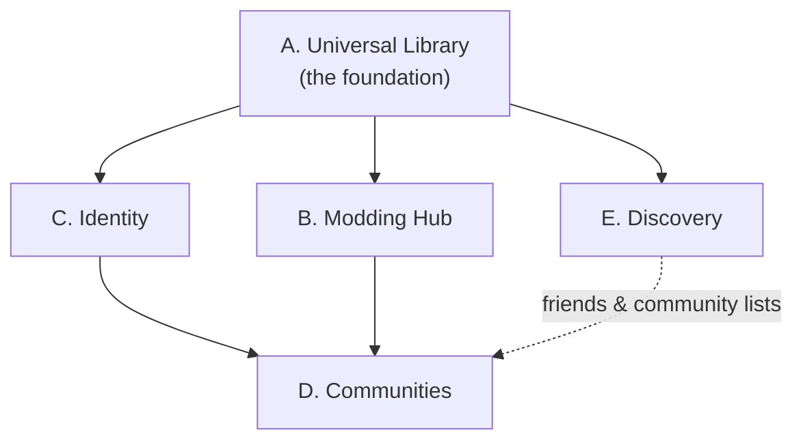

# 19 Product Vision

Back to [[00 Home]] · Roadmap: [[28 Expanded Development Roadmap]] · Why the plan changed: [[18 Plan Review 2026-11-13]]

> [!abstract] Status: proposed long-term vision
> Nothing on this page is built unless it says ✅. What exists today is described in [[00 Home]] and the code's `README.md`. This page is the **direction**; [[28 Expanded Development Roadmap]] is the **order**.

## One sentence
**GameLib is the place your PC gaming life lives:** every game you own, the mods you run, what you've played and achieved, and the people you play with, in one local-first app that sits *beside* Steam, Epic and GOG instead of trying to replace them.

## Why would someone use it if they already have Steam, Epic and GOG?
Each store only knows about itself. GameLib's value is everything that is **across** stores:

| Problem today | What GameLib does about it |
|---|---|
| Games are split across 4–6 launchers | One library, one search, one Play button ✅ (Steam/Epic/GOG today) |
| The same game owned twice shows up twice, with split playtime | One game, many installations and ownerships ([[20 Game Identity and Installation Model]]) |
| Playtime and stats are per-store | Unified playtime, stats and milestones across stores |
| Modding means juggling Nexus, Vortex, MO2, r2modman, Prism… per game | A modding hub that *coordinates* those tools per game ([[22 Modding Architecture]]) |
| Your gaming identity is "your Steam profile" | An optional GameLib profile that shows *all* of your gaming ([[23 Social Platform Architecture]]) |
| Finding the next game: store front pages built to sell | Discovery built from *your* library, your friends and community lists, with price comparison across stores ([[25 Game Discovery]]) |

## The five pillars

Everything depends on the library being right. A game that appears twice, or is matched to the wrong metadata, breaks mod matching, stats, profiles and recommendations. That is why **Phase 1 is the data model**, not features.

### A. Universal Library: the foundation
- **Built ✅:** Steam, Epic (manifests + `.egstore` folder fallback), GOG, folder scan, manual add; launching through the original launcher; playtime for games started from GameLib; covers; tags, favourites, collections; stats.
- **Planned next 🔜:** canonical games with multiple installations/ownerships; a provider registry so new stores are one file each; Ubisoft Connect, EA app and Xbox/Microsoft Store detection; metadata for non-Steam games (IGDB); duplicate detection and merging.
- **Future 🔭:** owned-but-not-installed games from linked accounts; achievements where APIs allow; playtime import from providers.

### B. Modding Hub: integrate, don't rebuild
GameLib does not try to become Vortex or Mod Organizer 2. It **browses** mod sites, **knows** which mod manager each game uses, **hands off** installs to that tool where one exists, and only installs mods **itself** for games with a simple, well-understood method (e.g. BepInEx/Thunderstore games, "drop into a folder" games). See [[22 Modding Architecture]].

### C. Identity: optional, never required
The local profile ✅ stays and keeps working offline forever. An **optional** GameLib account later lets you publish that profile, follow friends and share activity. External accounts (Steam, Epic…) are **linked to**, never **used as**, your GameLib identity. See [[23 Social Platform Architecture]].

### D. Communities: about games, not chat
Game pages with reviews, guides, shared lists and shared mod collections, all tied to the canonical game record. Not a Discord clone: no voice, no real-time chat servers. See [[23 Social Platform Architecture#Communities]].

### E. Discovery: from your library outwards
Wishlists, release tracking, price comparison across stores (via aggregator APIs), "what should I play next" from your backlog, and later recommendations from friends and community lists. **No storefront.** GameLib links to the store page to buy. See [[25 Game Discovery]].

## Principles (these are the tie-breakers)
1. **Local-first.** Everything in the library works with no internet and no account. Online features add to it; they never gate it.
2. **Complement, don't compete.** Launch through the original launcher; buy on the original store; mod with the established tool.
3. **One game, many sources.** A game is not the same thing as an installation or a store listing ([[20 Game Identity and Installation Model]]).
4. **Providers are plug-ins in spirit.** Adding a store, metadata source or mod site should be one new file plus one registration line ([[21 Provider Architecture]]).
5. **Respect provider rules.** Use official APIs where they exist, document unofficial methods as risky, and never scrape behind logins or store other people's credentials ([[27 Future Integrations]]).
6. **Cosmetic-only rewards.** Stardust stays a fun progression system: no real money, no gambling, no trading ([[26 Progression and Stardust Economy]]).
7. **Solo-developer sized.** Each milestone ends in a working app. Features that need a server, moderation or money wait until the local product is genuinely good.

## What GameLib is not
- Not a storefront, and it does not sell games or keys.
- Not a DRM or launcher replacement: games that need Steam/Epic/EA/Ubisoft to run still start through them.
- Not a chat or voice app.
- Not a mod *host*: mods stay on Nexus, Modrinth, Thunderstore etc.
- Not cross-platform yet: **Windows first**. Linux is a "future possibility" only.

## How this differs from the original plan
The original [[01 Requirements]] were for a personal, local, single-user launcher, and that is what was built. The vision above **keeps all of it** and adds pillars B–E on top. The local-only assumption becomes **local-first**: the app still never *needs* the internet or an account. See [[18 Plan Review 2026-11-13]].

## Related existing tools (for reference, not copying)
| Tool | What it does well | What GameLib learns from it |
|---|---|---|
| **Playnite** (open source, MIT) | Library plugins per store, metadata plugins, themes | Provider/plugin split; store integrations live outside the core |
| **GOG Galaxy 2.0** | Integrations with many stores, unified stats | Unified library + "one game, many platforms" view |
| **Heroic / Lutris** | Open-source launchers for Epic/GOG on Linux | Store detection techniques; respecting unofficial-API risk |
| **Vortex / Mod Organizer 2** | Mature mod managers (both GPL-3.0) | Integrate with them; never re-implement virtual file systems or load-order sorting |
| **r2modman / Thunderstore Mod Manager** | Profile-based BepInEx mod installs | A simple deploy method GameLib *can* do natively |
| **Prism Launcher** | Minecraft instances + Modrinth/CurseForge | Hand Minecraft modding to it |
