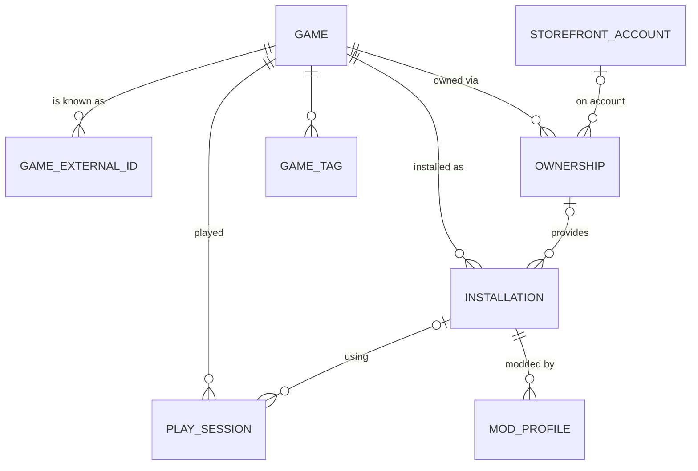

# 20 Game Identity and Installation Model

Back to [[00 Home]] · Schema: [[03 Data Model#Proposed schema v3+ (not built)]] · Roadmap: [[28 Expanded Development Roadmap#Phase 1 – Universal Library]]

> [!todo] Status: 🔜 planned next (Phase 1, milestones M11–M12)
> Today **one row in `games` = one installation from one store**. This page proposes how to separate them. Nothing here is built.

## The problem with today's model (✅ as built)
`games` has `UNIQUE(source, source_id)`. That was the right call for a first version: it stops rescans creating duplicates. But it mixes three different things into one row:

| Thing | Example | Where it lives today |
|---|---|---|
| **The game itself** | *Cyberpunk 2077* | `games.title`, `description`, `genres`, `favourite`, tags, playtime |
| **An ownership** (a licence on a store) | "I own it on GOG" and "I own it on Steam" | Implied by `games.source` |
| **An installation** (files on disk + how to start them) | `D:\GOG Games\Cyberpunk 2077\bin\x64\Cyberpunk2077.exe` | `install_dir`, `launch_*`, `installed` |

Consequences:
- Owning a game on Steam **and** GOG gives two unrelated library entries, with **playtime split** between them, two favourites, two tag sets.
- An uninstalled-then-reinstalled game from a different store loses its history.
- A game you own but haven't installed can't be represented except as "not installed" from a previous scan.
- Metadata and mods can't be attached to "the game" because there is no single row for it.

## The proposed model

| Concept | Meaning | Key rule |
|---|---|---|
| **Game** (canonical) | The thing you think of as "a game". Holds everything *you* decide: favourite, hidden, tags, collections, status (Backlog/Playing/Finished), your notes, chosen cover. | One per real game. Playtime totals live here. |
| **External ID** | What a provider calls this game: Steam app `1091500`, GOG `1423049311`, IGDB `1877`, SteamGridDB game id… | `UNIQUE(provider, external_id)`: the same external ID can never point at two games. This is what makes matching safe. |
| **Ownership** | "This game is in my library on store X" (optionally on a specific linked account). | May exist **without** an installation (owned, not installed). |
| **Installation** | Files on this PC and how to launch them. | May exist **without** a known ownership (folder scan, manual add, a DRM-free copy). `UNIQUE(provider, provider_key)` keeps rescans idempotent, exactly like today. |
| **Preferred installation** | Which installation the Play button uses when there are several. | Stored on the game; user can change it on the game page. |

> [!example] Cyberpunk 2077 owned on Steam and GOG, installed only from GOG
> - 1 `games` row: *Cyberpunk 2077*, ★ favourite, tag "RPG", playtime 63 h
> - 3 `game_external_ids`: `steam:1091500`, `gog:1423049311`, `igdb:1877`
> - 2 `ownerships`: Steam, GOG
> - 1 `installations`: GOG, `D:\GOG Games\Cyberpunk 2077`, exe launch — **preferred**
> - Play sessions point at the game (and record which installation was used)

## Matching: how scans decide "same game or new game?"
Run in this order; stop at the first that answers.

1. **Exact installation match.** `(provider, provider_key)` already exists → update that installation (today's behaviour, unchanged).
2. **Exact external-ID match.** The detected game's own ID (e.g. `steam:1091500`) already belongs to a game → attach the new installation/ownership to it.
3. **Cross-store ID match.** A metadata provider that publishes cross-store IDs links them. *IGDB has an "external games" resource that maps IGDB games to store IDs* (🔬 verify coverage for GOG/Epic/Xbox before relying on it). If the detected Steam/GOG/Epic ID maps to an IGDB ID that an existing game already has → **suggest** a merge.
4. **Fuzzy title match.** Normalised title (lower-case, strip ™®©, edition words like "GOTY", "Definitive Edition", punctuation) + release year if known → **suggest** a merge, never automatic.
5. Otherwise → **new game**.

**Automatic vs suggested:** only steps 1–2 attach automatically. Steps 3–4 put the pair on a **"Possible duplicates" review screen** (like today's folder-scan import review) where the user confirms. Wrong automatic merges are much worse than a visible duplicate.

### Things that look like duplicates but aren't
- **Editions and remasters** (*Skyrim* vs *Skyrim Special Edition*) are usually different games with different mods. Treat as separate unless the user merges.
- **DLC** is not a game. Epic DLC is already filtered (✅ `tests/fixtures/epic_dlc.item`).
- **Demos / playtests** have their own store IDs: separate games.

### Merging and un-merging
- **Merge (user action):** move installations, ownerships, external IDs, sessions, tags and showcase slots from game B to game A; sum nothing (playtime totals are recomputed from sessions); keep A's user choices, fill blanks from B; delete B. Record it in a `game_merges` log row so it can be explained and undone.
- **Split (undo):** a merge log row stores which installations/ownerships/external IDs came from B, so "Split" can recreate B. Sessions follow their installation.
- Both run in **one transaction** (the `Db::transaction` helper already exists ✅).

## Playtime with several sources
- **GameLib-tracked sessions** (✅ today) stay the source of truth for anything GameLib launched.
- **Provider-reported playtime** (e.g. Steam's `playtime_forever` from `IPlayerService/GetOwnedGames`, 🔜 Phase 1 M14) is stored **separately** per provider, never added to GameLib's total, because Steam also counts the sessions GameLib launched. The game page shows both ("GameLib: 12 h · Steam reports: 40 h"); stats use a clearly labelled choice (default: the larger of the two per game, so pre-GameLib history counts without double counting).
- Stardust is only ever paid for **GameLib-tracked** time ([[26 Progression and Stardust Economy]]).

## Launching with several installations
- Play uses the preferred installation. If it's missing, fall back to any installed one and say so in the status bar.
- The game page lists installations ("Steam · installed", "GOG · installed · preferred", "Epic · owned, not installed → Install in Epic") with an "Install" link that opens the store's own install URI where one exists.

## Migration from today's schema (keeps every game id)
Game ids are referenced by `play_sessions`, `game_tags`, `profile_showcase` and `stardust_ledger.game_id`, so **existing ids must not change**.

Migration **v3** (one transaction, like every migration ✅):
1. Create the new tables (`installations`, `ownerships`, `game_external_ids`, `game_merges`…).
2. For each existing `games` row: insert one `installations` row from its `source`, `source_id`, `install_dir`, `launch_*`, `installed`; one `game_external_ids` row for steam/epic/gog; one `ownerships` row for steam/epic/gog; set `games.preferred_installation_id`.
3. Leave the old columns in place but unused (SQLite can't drop a column that is part of a `UNIQUE` constraint without rebuilding the table).

Migration **v4**, once all code reads installations: rebuild `games` without the installation columns (create new table → copy → drop old → rename, the standard SQLite recipe).

Test it like the existing migration tests ✅: build a v2 database in a temp dir with known games, sessions, tags and showcase rows, open it with the new code, and check nothing moved.

## Open questions
- [ ] Should step 3 (IGDB cross-store match) auto-merge when the IGDB match is exact on **two** store IDs? *Suggestion: no, always ask, at least until it has proved reliable on my own library.*
- [ ] Should "Finished" stay a collection (tag) or become a `status` column (Backlog/Playing/Finished/Abandoned)? *Suggestion: status column in v3, keep the "Finished" collection working by mapping it.*
- [ ] Which provider's playtime wins in stats when they disagree? *Suggestion above: the larger per game, labelled.*
