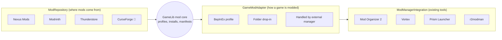

# 22 Modding Architecture

Back to [[00 Home]] · Vision: [[19 Product Vision#B. Modding Hub: integrate, don't rebuild]] · Roadmap: [[28 Expanded Development Roadmap#Phase 2 – Modding Hub]] · Research: [[27 Future Integrations#Mod repositories]]

> [!abstract] Status: 🔭 future (Phase 2, after the universal library)
> Nothing on this page is built. It depends on [[20 Game Identity and Installation Model]] (mods attach to an **installation** of a **canonical game**) and [[21 Provider Architecture]].

## The rule: integrate, don't rebuild
Modding is very different per game. Bethesda games need load orders, plugin files and ideally a virtual file system; Unity games often use BepInEx; Minecraft has its own launcher ecosystem; many games just want files dropped in a folder. Mature, free tools already solve the hard cases:

| Ecosystem | Established tool | GameLib's role |
|---|---|---|
| Bethesda (Skyrim, Fallout), Cyberpunk, Witcher 3, many Nexus games | **Mod Organizer 2** (GPL-3.0, virtual file system) or **Vortex** (GPL-3.0, Nexus's own) | **Browse + hand off.** Detect the tool, show its profiles, launch the game *through* it. Never re-implement the VFS, load-order sorting (LOOT) or FOMOD installers. |
| Thunderstore games (Lethal Company, Valheim, Risk of Rain 2…) | r2modman / Thunderstore Mod Manager | **Native support is realistic**: packages are zips with a manifest and dependency strings; install = copy into a BepInEx profile folder. |
| Minecraft (Java) | **Prism Launcher** (+ Modrinth / CurseForge) | **Hand off** to Prism. Show Modrinth browsing; "Open in Prism". |
| "Drop files into `Mods/`" games | none needed | **Native support**: copy files, record every file written, remove exactly those on uninstall. |
| Games with in-game mod browsers (mod.io, Steam Workshop) | the game itself | **Show only**: link out; don't manage. |

## Four kinds of modding provider


```rust
/// Where mods are listed and downloaded from.
pub trait ModRepository {
    fn info(&self) -> &ProviderInfo;
    /// Which of my games does this repository know? (e.g. Nexus "game domain", Thunderstore "community")
    fn game_key(&self, game: &GameIdentity) -> Option<String>;
    fn search(&self, ctx: &ProviderCtx, game_key: &str, q: &ModQuery) -> Result<Page<ModSummary>>;
    fn details(&self, ctx: &ProviderCtx, game_key: &str, mod_id: &str) -> Result<ModDetails>; // description, images, files, deps
    /// A direct download, if this repository and account allow it (see Nexus notes below).
    fn download(&self, ctx: &ProviderCtx, file: &ModFileRef) -> Result<DownloadPlan>;
    fn latest_versions(&self, ctx: &ProviderCtx, installed: &[ModFileRef]) -> Result<Vec<UpdateInfo>>;
}

pub enum DownloadPlan {
    Direct(Url),                    // Modrinth, Thunderstore, Nexus Premium
    OpenInBrowser(Url),             // Nexus free accounts: user clicks "Mod Manager Download"
    HandOff { manager: ProviderId, uri: String }, // e.g. let Vortex/MO2 handle an nxm:// link
}

/// An existing mod manager on this PC.
pub trait ModManagerIntegration {
    fn info(&self) -> &ProviderInfo;
    fn detect(&self, ctx: &ProviderCtx) -> Result<Vec<ManagerInstance>>;     // e.g. MO2 instances
    fn profiles(&self, inst: &ManagerInstance) -> Result<Vec<ExternalModProfile>>; // read-only view
    fn launch_target(&self, inst: &ManagerInstance, profile: &str, exe: &str) -> Result<LaunchTarget>;
}

/// How one game is modded.
pub trait GameModAdapter {
    fn id(&self) -> &'static str;                          // "bepinex", "folder_dropin", "external"
    fn supports(&self, game: &GameIdentity, inst: &Installation) -> bool;
    fn install(&self, profile: &ModProfile, archive: &Path) -> Result<DeployManifest>; // every file written + hash
    fn uninstall(&self, manifest: &DeployManifest) -> Result<()>;                       // remove exactly those files
    fn launch_target(&self, profile: &ModProfile, base: &LaunchTarget) -> Result<LaunchTarget>;
}
```
- **Per-game support is data, not code**: a small built-in table maps known games (by external ID) to an adapter and repository keys, e.g. `steam:1966720 (Lethal Company) → bepinex, thunderstore:lethal-company`. The user can override it.
- Unknown game → "Modding not supported yet" with links to the game's Nexus/Thunderstore page if one exists.

## Mod profiles
- A **mod profile** belongs to one **installation** (not to the game: Steam and GOG copies can differ). Fields: name, adapter, enabled mods with pinned versions, load order (only where the adapter uses one).
- **Native adapters** keep each profile's files *outside* the game folder where possible (BepInEx profiles can be separate folders, like r2modman does 🔬 verify the doorstop launch arguments), so switching profile doesn't overwrite game files.
- **Drop-in adapter** can only have **one active profile** at a time (files really live in the game folder). Switching = uninstall manifest A, install manifest B. Warn before touching game files; never delete a file GameLib didn't write.
- **External-manager profiles** (MO2/Vortex) are **read-only mirrors**: GameLib shows them and launches with them; editing happens in the tool.
- "Play with profile ▾" on the game page: chooses which profile's `launch_target` is used. Playtime tracking is unchanged (the game's exe still runs inside the install folder) ✅ — except MO2 launches via its own exe 🔬 verify the tracker still sees the game.

## Dependencies and conflicts
- **Dependencies:** Thunderstore manifests list dependency strings (`Author-Name-1.2.3`); Modrinth versions list dependencies; Nexus has "requirements" on the mod page (exposed via API 🔬 check which version of the API). GameLib resolves what it can, shows what it can't ("Requires SKSE: install manually").
- **Conflicts:** native adapters detect **file conflicts** from manifests (two mods write the same path) and ask which wins. Semantic conflicts (plugins, scripts) are out of scope → MO2/LOOT territory.

## Collections
- **Local first (Phase 2):** export a profile as a small JSON file: game external IDs, repository, mod IDs, pinned versions, adapter, load order. Import = resolve and download each. No server needed; share the file any way you like.
- **Nexus Collections** already exist on Nexus and are installed by Vortex. GameLib links to them rather than re-implementing them.
- **Community-shared collections (Phase 5)** reuse the same JSON format, published to the GameLib backend ([[23 Social Platform Architecture#Communities]]).

## Provider facts and restrictions (researched 13 Nov 2026)
> [!warning] Check the official docs again before building. These change.

| Repository | Access | Key restrictions | Plan |
|---|---|---|---|
| **Nexus Mods** | REST API v1 (+ newer GraphQL v2). Users can paste a **personal API key**. | Help-centre article: **20,000 requests/day, then 500/hour**, resetting 00:00 GMT. The **direct download-link endpoint is Premium-only**; free users download via the site's "Mod Manager Download" button, which opens an `nxm://` link. The **API Acceptable Use Policy says personal keys are not for public-facing apps**: a public app must be **registered** with Nexus to get SSO (and, per community docs, newer OAuth 2.0 client IDs 🔬). Registration can be refused. | Phase 2a: browse/read with the user's own key (fine while GameLib is a personal/coursework tool). **Before any public release: apply for app registration.** Downloads: Premium → direct; free → hand off to Vortex/MO2 or open the page. Don't register as the `nxm://` handler by default (it would fight Vortex/MO2); make it opt-in. |
| **Modrinth** | Public REST API, no key for reading. | **300 requests/minute**; must send a **uniquely identifying User-Agent**. Content is mostly Minecraft (mods, modpacks, shaders, resource packs). | Read-only browse for Minecraft; hand off installs to **Prism Launcher** (don't build a Minecraft launcher). |
| **Thunderstore** | Public API per community (`/c/<community>/api/v1/package/`), plus newer experimental endpoints. | Full package lists are large: cache them, refresh rarely. 🔬 Check current API docs and rate limits. | **Best first native target**: simple zip+manifest format, clear dependencies, BepInEx deploy. |
| **CurseForge** | API needs an approved key (application). | 🔬 Terms reportedly let mod authors **opt out of third-party distribution** (a flag in API responses) — must be respected. | Low priority; Prism already covers Minecraft. |
| **mod.io** | API with keys; games opt in. | Many mod.io games have in-game browsers. | Link out only. |
| **Steam Workshop** | Subscriptions handled by Steam. | No reason to duplicate. | Show subscribed count at most (🔬 needs research). |

| Manager | What GameLib can read/do | Confidence |
|---|---|---|
| **Mod Organizer 2** | Instances (portable or in `%LOCALAPPDATA%\ModOrganizer`), `profiles/<name>/modlist.txt`; launch through MO2 with a profile from the command line (`-p <profile>` + `moshortcut://`). | 🔬 verify CLI syntax and instance discovery on a real install |
| **Vortex** | Handles `nxm://` links; profiles stored in its own state database. | 🔬 Vortex state is not a public format; likely **detect + open** only |
| **Prism Launcher** | Instances folder; command-line launch of an instance. | 🔬 verify CLI flag |
| **r2modman** | Profiles in its data folder. | 🔬 research; GameLib may simply replace it for supported games |

## Licensing
Vortex and MO2 are **GPL-3.0**. Reading their source to learn how they work is fine; **copying their code into GameLib would require GameLib to be GPL-3.0 too**. GameLib's own licence isn't chosen yet (see [[12 Decisions Log#Still open]]).

## Safety
- Mods are code from the internet. GameLib only downloads from the repository's own CDN over HTTPS, checks archive hashes where the repository provides them, and never runs installers (`.exe` mod installers → hand off to the user).
- Extract archives into a temporary folder, reject path traversal (`..\`), cap sizes (same idea as today's cover-download checks ✅).
- Every native install writes a **deploy manifest**, so uninstall is exact and "Verify files" can detect manual changes.

## Out of scope (Phase 2)
- Virtual file systems, load-order sorting, FOMOD/BAIN installer scripting, script extenders' installers, save-game cleaning.
- Hosting mods or mirroring other sites' files.
- Mod creation tools.
