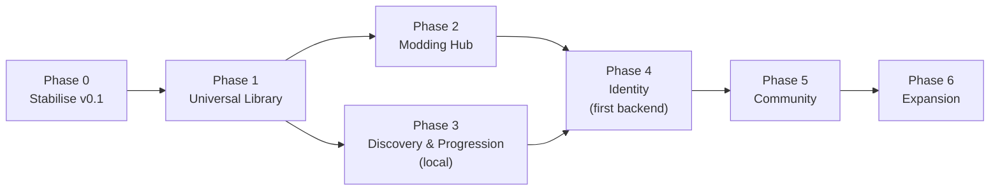

# 28 Expanded Development Roadmap

Back to [[00 Home]] · Vision: [[19 Product Vision]] · Original milestones M0–M8: [[09 Milestones]] · Why: [[18 Plan Review 2026-11-13]]

> [!important] How to read this
> - **Phase 0** finishes what exists. **Phase 1** is planned in detail ("planned next"). Phases 2–6 get less detail on purpose: they will be re-planned when Phase 1 is done.
> - Milestone numbers continue from the original plan (M0–M8 in [[09 Milestones]]), so M9 is the next one.
> - Every milestone ends with a **working, releasable app**, like M0–M8 did.
> - Sizes: **S** ≈ 1–3 sessions · **M** ≈ 4–8 · **L** ≈ 9–15 · **XL** = break it down further before starting. (A "session" = one evening/afternoon of work.)

## Order and why it changed
The suggested order was Library → Mods → Identity → Community → Discovery. **Changed:** a local-first **Discovery & Progression** phase moves **before Identity**.

Reasons:
1. Wishlists, release tracking, price comparison, "play next" and Stardust v2 need **no server**, only the metadata Phase 1 adds. They make the app more useful sooner, at low risk.
2. Identity and Community need a backend, auth, privacy work, moderation and legal reading. That's the biggest jump in risk and running cost, so it should come when the local product is strong enough that people would want an account.
3. Social discovery (friends, community lists) still comes later, with Phases 4–5.

Phases 2 and 3 are independent of each other; they can swap if modding turns out less interesting than discovery in practice.

---

## Phase 0 – Stabilise and release v0.1
**Objective:** prove the existing app works on real hardware with real games, finish the coursework, and ship a tagged release. **No new features.**

| | |
|---|---|
| **Features** | None new. Fixes only |
| **Technical requirements** | Real Steam/Epic/GOG installs; SteamGridDB + Steam Web API keys; Windows 11 |
| **Dependencies** | None |
| **Difficulty** | Low–Medium (the unknowns are the live APIs and GOG) |
| **Risks** | Live API responses differ from fixtures; GOG registry layout differs; playtime tracking misses games whose exe runs outside the install folder (anti-cheat launchers, EA/Ubisoft wrappers) |
| **Out of scope** | Any schema change, new providers, new screens |

### M8 (finish): write-up
- [ ] Dev log entries ([[13 Dev Log Template]]) for the sessions so far, reconstructed from Git history and the "Found and fixed" list in [[09 Milestones]]
- [ ] Coursework write-up

### M9: Acceptance and v0.1 release (S–M)
- [ ] Run every **"Done when"** check in [[09 Milestones]] (M1–M7) and record results (a short **Acceptance Test Log** note with date, what was tried, pass/fail, screenshot)
- [ ] Specifically verify: GOG detection, Epic launch links **and the `.egstore` fallback**, a 10-minute Steam and Epic session, file pickers, live SteamGridDB / Steam Store / Steam Web API calls
- [ ] Fix what fails; add a regression test for each fix where possible
- [ ] **Commit the current uncommitted work** (Epic folder fallback, icon, window size, README, worker changes) in sensible commits
- [ ] GitHub Actions on `windows-latest`: `cargo fmt --check`, `cargo clippy -D warnings`, `cargo test` (already suggested in [[08 Errors and Testing]], not yet set up)
- [ ] Choose a licence ([[12 Decisions Log#Still open]])
- [ ] Tag **v0.1.0**, attach `gamelib.exe` to a GitHub release

**Completion criteria:** all M1–M7 "Done when" lines ticked or turned into known-issues; CI green; v0.1.0 tagged; write-up drafted.

---

## Phase 1 – Universal Library
**Objective:** make the library *correct* across stores (one game, many installations/ownerships), make adding providers cheap, and fill metadata gaps. This is the foundation for every later pillar.

| | |
|---|---|
| **Features** | Provider registry; canonical games with installations/ownerships/external IDs; duplicate review, merge & split; IGDB metadata for every game; hero/logo art; Ubisoft Connect; generic installed-program import; EA/Xbox **spikes**; Steam account: owned-not-installed games, Steam-reported playtime, Steam achievements; list view, status (Backlog/Playing/Finished), smart filters |
| **Technical requirements** | Workspace split; schema v3/v4 migrations; `keyring` (Credential Manager); per-provider rate limiter + disk cache; Twitch developer app for IGDB; possibly the `windows` crate (Xbox spike) |
| **Dependencies** | Phase 0 (a trusted baseline before changing the data model) |
| **Difficulty** | Medium–High: the migration must not lose anyone's history; matching is fiddly |
| **Risks** | Migration bugs (mitigation: migration tests on copies of a real `library.db`, automatic backup before migrating); wrong auto-merges (mitigation: only exact-ID auto-merge); EA/Xbox detection not feasible (mitigation: spikes are time-boxed, folder scan is the fallback); IGDB terms for a public app ([[27 Future Integrations]]) |
| **Out of scope** | Mods, accounts, prices, installing games ourselves, Linux |

### M10: Provider registry and workspace (M)
- [ ] Workspace: `gamelib-core` + `gamelib-desktop` ([[21 Provider Architecture#Single crate or workspace?]])
- [ ] `ProviderInfo` + `LibraryProvider` trait + `builtin_providers()`; UI colours/badges/settings rows come from providers
- [ ] Replace the `Source` enum with `ProviderId` (no data migration: values are already text)
- [ ] SteamGridDB / Steam Store / Steam friends moved behind `MetadataProvider` / `SocialProvider`
- [ ] API keys moved to Windows Credential Manager (with one-time migration out of `settings`)
- [ ] Rate limiter + response cache in `ProviderCtx`
- **Done when:** adding a dummy provider is one file + one line, and all existing tests pass.

### M11: Games, installations and ownerships (L)
- [ ] Schema v3 ([[03 Data Model#Proposed schema v3+ (not built)]]), keeping every game id ([[20 Game Identity and Installation Model#Migration from today's schema (keeps every game id)]])
- [ ] Automatic backup of `library.db` before any migration
- [ ] Scans write installations/ownerships; game page lists installations; preferred installation picker
- [ ] `status` column (Backlog/Playing/Finished/Abandoned) mapped from the "Finished" collection
- [ ] Add `uuid` + `updated_at` to user-editable rows (cheap now, needed for sync in Phase 6)
- **Done when:** a v2 library migrates with identical playtime, tags, showcase and Stardust; a game installed from two stores can be one entry.

### M12: Metadata v2 and duplicates (L)
- [ ] IGDB `MetadataProvider`: description, genres, themes, release date, developer/publisher, external store IDs
- [ ] "Possible duplicates" review screen; merge and split with a `game_merges` log
- [ ] Artwork kinds: cover ✅, hero, logo, icon (SteamGridDB); hero banner on the game page
- [ ] Schema v4: drop installation columns from `games`
- **Done when:** almost every game (not just Steam ones) has a description and genres; my real duplicates are found and merged correctly.

### M13: More stores (M, plus time-boxed spikes)
- [ ] Ubisoft Connect provider (registry + `uplay://`) 🟡
- [ ] "Installed programs" import from Uninstall registry entries → existing import review screen
- [ ] **Spike (max 2 sessions each):** EA app, Xbox/Microsoft Store, GOG Galaxy database. Ship only what works reliably; write up the rest in [[27 Future Integrations]]
- [ ] Playtime tracker: support an optional **extra watch path / process name** per installation (for games whose exe lives outside the install folder)
- **Done when:** every installed game on my PC appears exactly once, from any launcher I use.

### M14: Linked Steam account data (M)
- [ ] Owned-but-not-installed Steam games (`GetOwnedGames`), shown as "Not installed · Install in Steam"
- [ ] Steam-reported playtime stored separately and shown beside GameLib's ([[20 Game Identity and Installation Model#Playtime with several sources]])
- [ ] Steam achievements per game (`GetPlayerAchievements` + schema), achievement count on game page and profile
- **Done when:** my whole Steam library and its achievements show up, with no double-counted playtime.

### M15: Organising upgrades (S–M)
- [ ] List view (from Daylight List, [[C - Daylight List]]) as the grid/list toggle
- [ ] Filters: provider, genre, status, installed, has mods (later); **saved filters** shown in the sidebar like collections
- [ ] Optional: track games launched outside GameLib (watch known install folders), the open question from [[12 Decisions Log]] (S–M, opt-in)
- **Done when:** I can slice my library any way I want in a few clicks.

**Phase 1 completion criteria:** schema v4 live with no data loss; ≥ 5 library providers through the registry; non-Steam games have metadata; duplicates handled; Steam account data imported; v0.2–v0.4 released along the way.

---

## Phase 2 – Modding Hub
**Objective:** see and manage mods per game from GameLib, integrating established tools, with native support only for simple methods. Detail: [[22 Modding Architecture]].

| | |
|---|---|
| **Features** | Mod browsing (Thunderstore, Modrinth, Nexus); per-game support table; MO2/Vortex/Prism detection + "Play with profile"; native BepInEx (Thunderstore) and drop-in adapters; install/update/uninstall with deploy manifests; dependency resolution; file-conflict warnings; collections as JSON files |
| **Technical requirements** | Zip (and possibly 7z) extraction with path-traversal checks; hashing; mod tables in schema ([[03 Data Model]]); Nexus personal key (personal use) or registered app (public) |
| **Dependencies** | Phase 1 (installations, external IDs, providers) |
| **Difficulty** | High (every game is different; touching game folders is risky) |
| **Risks** | Breaking a user's game install (mitigation: manifests, never delete untracked files, "verify files"); Nexus registration refused (mitigation: browse-only + hand off to Vortex/MO2); tool formats change (mitigation: read-only integrations, clear errors) |
| **Out of scope** | VFS, load-order sorting, FOMOD, hosting mods, mod creation tools |

Milestones (re-plan in detail when Phase 1 ends):
- **M16 Mod browsing (M):** ModRepository trait; Thunderstore + Modrinth read-only; Nexus with personal key; mod pages with images, description, requirements; per-game support table.
- **M17 Existing mod managers (M):** detect MO2 instances/profiles, Vortex, Prism; launch through MO2 with a profile 🔬; playtime still tracked.
- **M18 Native mod profiles (L):** BepInEx/Thunderstore adapter: profiles, dependency resolution, install/update/uninstall, update checks.
- **M19 Drop-in adapter + collections (M):** folder drop-in with manifests and conflict warnings; export/import profile JSON.

**Completion criteria:** for at least one Thunderstore game GameLib installs, updates and removes mods with profiles; for one MO2 game it launches the chosen MO2 profile; a collection file round-trips between two PCs.

---

## Phase 3 – Personal Discovery & Progression (local-first)
**Objective:** help the user decide what to play and buy next, and deepen the Stardust system, all without a server. Detail: [[25 Game Discovery]], [[26 Progression and Stardust Economy]].

| | |
|---|---|
| **Features** | Wishlist; release tracking; Discover tab; price comparison + alerts (ITAD/CheapShark); "play next" backlog picker; content-based recommendations; Steam friends' games; XP & levels; idle filter + daily cap; themes import/export; **shareable profile card** (image/JSON); optional Discord Rich Presence |
| **Technical requirements** | IGDB (Phase 1); ITAD key; Windows idle API |
| **Dependencies** | Phase 1 (metadata, canonical games without installations). Not Phase 2 |
| **Difficulty** | Medium |
| **Risks** | Price API terms/approval; recommendation quality (mitigation: explainable rules first) |
| **Out of scope** | Storefront, affiliate links, collaborative filtering, accounts |

Milestones: **M20** Wishlist + releases + Discover tab (M) · **M21** Prices + alerts (S–M) · **M22** Play next + recommendations (M) · **M23** Stardust v2 + themes + profile card (M).

**Completion criteria:** wishlist with prices and release dates works; recommendations are explainable; rewards are capped and idle-filtered with tests.

---

## Phase 4 – GameLib Identity (first backend)
**Objective:** optional accounts and public profiles, with privacy and safety built in from the first day. Detail: [[23 Social Platform Architecture]], [[24 Backend and Cloud Infrastructure]].

| | |
|---|---|
| **Features** | Accounts (browser sign-in, PKCE); Steam linking via OpenID; publish profile per section with visibility; follow + friends; block/report; opt-in activity feed; server-side Stardust ledger with caps; account delete/export |
| **Technical requirements** | Backend (Supabase or PocketBase after a spike; or own axum server); object storage for avatars/banners; ToS + privacy policy; `gamelib-api-types` crate |
| **Dependencies** | Phases 1 and 3 (profile, stats, rewards worth publishing). Phase 2 optional |
| **Difficulty** | High |
| **Risks** | Security mistakes; legal duties (UK GDPR, Online Safety Act); free-tier limits/pausing; running cost; an adult must own the service |
| **Out of scope** | Chat/DMs, payments, leaderboards, community content |

Milestones: **M24** Backend spike + decision + legal reading (M) · **M25** Accounts + Steam linking (L) · **M26** Published profile + privacy controls (M) · **M27** Follows/friends + activity feed + block/report, **private beta** (L).

**Completion criteria:** a small group of invited users can sign up, publish profiles, follow each other and see opt-in activity; deleting an account removes server data; no private data visible to others (tested).

---

## Phase 5 – Community
**Objective:** game-centred community content tied to the canonical game and mod collections.

| | |
|---|---|
| **Features** | Moderation tooling (queue, removal, suspensions, audit log); game community pages; reviews with tracked hours; shared lists; shared mod collections; screenshots; guides; (maybe) threaded discussions |
| **Technical requirements** | Shared game key across users (IGDB ID); media pipeline; text/image moderation approach |
| **Dependencies** | Phase 4; Phase 2 for shared mod collections |
| **Difficulty** | High (moderation and scale more than code) |
| **Risks** | Abuse and illegal content; storage/egress costs; empty-community problem (mitigation: start with lists and collections, which are useful even with few users) |
| **Out of scope** | Real-time chat/voice, video hosting, forums at launch |

Milestones: **M28** Moderation tools + game pages + reviews · **M29** Shared lists + mod collections · **M30** Screenshots + guides · **M31** Discussions (only if needed).

---

## Phase 6 – Expansion (future possibilities)
Not committed. Pick from these once Phase 5 is stable:
- **Cloud sync** of user decisions between PCs ([[24 Backend and Cloud Infrastructure#Cloud sync (Phase 6)]])
- **Mobile companion**: read-only web view of library/profile/wishlist + price alerts (a responsive web page is far cheaper than a native app)
- Social discovery: friends' activity and community lists in recommendations; groups & LFG
- Formal plugin system (WASM or out-of-process) if outside contributors appear ([[21 Provider Architecture#A formal plugin system? Not yet.]])
- Couch Mode / controller UI ([[D - Couch Mode]])
- More stores (Battle.net, Amazon, itch.io), emulators
- Linux support (egui and Rust make it possible; the store detection and launching would need per-OS providers)

---

## Recommended next milestone
**M9: Acceptance and v0.1 release** (Phase 0). Concretely, in this order:
1. Commit the uncommitted work.
2. Run the "Done when" checks with real keys and games; log results.
3. Fix what breaks; set up CI; choose a licence; tag v0.1.0.
4. Write the dev log entries and coursework write-up while the details are fresh.

Then start **M10** (provider registry + workspace), the smallest Phase 1 step that makes everything after it cheaper.
